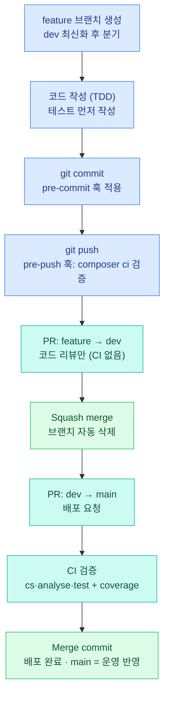

# AICreo — CI4 웹에이전시 보일러플레이트

> 1인 웹에이전시를 위한 CodeIgniter 4 기반 홈페이지 빠른 납품 구조

---

## 개요

클라이언트 홈페이지를 반복 제작할 때 **코어는 재사용하고 껍데기만 교체**하는 방식으로  
단순 홈페이지는 3~5일, 중형 사이트는 1~2주 납품을 목표로 설계된 보일러플레이트입니다.

> 📘 **운영자·개발자 통합 매뉴얼**: 각 관리자 화면의 입력 필드·옵션·동작과 방문자 기능을 정리한 상세 매뉴얼은 [`docs/manual.md`](docs/manual.md) 를 참고하세요.
>
> 🏛️ **시스템 아키텍처**: CodeIgniter 4 요청 흐름, 인증·관리자 경계, 데이터 계층과 외부 연동 구조는 [아키텍처 다이어그램](architecture/aicreo-architecture.html)에서 확인할 수 있습니다.
>
> 🧩 **플러그인 개발**: 코어를 건드리지 않고 기능을 추가하는 방법은 [`docs/plugin-development.md`](docs/plugin-development.md), 설계 배경은 [`docs/plugin-architecture.md`](docs/plugin-architecture.md), 이벤트 규약은 [`docs/plugin-events.md`](docs/plugin-events.md) 를 참고하세요.
>
> ⚙️ **설치·서버 설정**: 처음부터 띄우는 절차와 운영 서버 설정(크론·`.env`)은 [`SETUP.md`](SETUP.md) 에 있습니다.

---

## 주요 기능

### 프론트
| 기능 | 설명 |
|------|------|
| 동적 페이지 | 슬러그 기반 자동 라우팅, 레이아웃 선택 (기본 / 문의 / 랜딩) |
| 홈페이지 | 히어로 · 서비스 소개 · 최신 공지 · CTA 섹션 |
| 문의폼 | 이름·이메일·연락처·내용 입력 → DB 저장 + 이메일 자동 발송 |
| 회원 인증 | 회원가입 · 로그인 · 로그아웃 · 프로필/비밀번호 관리 |
| 소셜 로그인 | Google · Naver · Kakao OAuth 로그인 (신규 자동 가입 · 기존 계정 연동) |
| 반응형 GNB | DB 메뉴 기반 드롭다운 네비게이션 (Bootstrap 5) |
| 마케팅 오버레이 | 배너(위치별) · 팝업(전체/홈/특정 페이지) 기간 기반 자동 노출 |
| SEO | OG태그 · 메타 설명 · Google Analytics · 네이버 웹마스터 자동 삽입 |
| SEO/GEO 크롤러 | `sitemap.xml` · `robots.txt` · `llms.txt` · IndexNow 자동 색인 제출 |

### 게시판
| 기능 | 설명 |
|------|------|
| 다중 게시판 | 슬러그별 독립 게시판 (공지사항 · 자유 · 문의 등) |
| 권한 관리 | 읽기·쓰기 권한을 **비회원 / 회원 / 관리자** 단위로 게시판별 설정 |
| 위지윅 에디터 | TinyMCE 6 기반 글쓰기·수정, 이미지 붙여넣기·업로드 지원 |
| 파일 첨부 | 이미지 + 일반 파일 복수 첨부, 확장자 화이트리스트 보안, 최대 10MB |
| 비회원 게시 | 이름 + 비밀번호 입력으로 작성·수정·삭제 |
| 댓글 | 회원·비회원 댓글, 소프트 삭제 |
| 검색 | 제목 / 내용 / 제목+내용 키워드 검색 |
| 공지글 | 관리자 전용 상단 고정 공지 (최대 5개 표시) |
| 비밀글 | 작성자·관리자만 열람 가능 |

### 블로그·콘텐츠 운영
| 기능 | 설명 |
|------|------|
| 시리즈(연재) | 한 글을 여러 시리즈에 묶고 상세 상단에 이전/다음 내비 표시, `/series` 목록·소개 페이지, **AI 추천**(Groq)으로 어울리는 시리즈 제안 |
| 글 AI 제안 | 글쓰기 화면에서 요약(메타 설명)·태그·제목 후보 제안 — "적용"을 누른 항목만 반영 (운영자 전용) |
| 태그·아카이브·인기글 | 태그 페이지, 월별 아카이브, 조회수 기반 인기글, 관련 글, 공감(좋아요) |
| 예약 발행 | 미래 시각을 지정하면 `posts:publish-scheduled` 가 시각이 지난 글을 공개 |
| 수정 이력 | 제목·본문·메타 설명이 바뀔 때마다 이전 상태 저장(글당 50개), 줄 단위 비교와 복구 |
| 휴지통 | 글·댓글·페이지 소프트 삭제, 복원·영구 삭제, 30일 후 자동 비움 |
| 미리보기 공유 링크 | 비공개·예약 글을 만료 기한이 있는 토큰 주소로 공유(noindex, 조회수 미반영) |
| 뉴스레터 | 푸터 구독 폼 → 이메일 확인(더블 옵트인) → 공개 글 자동 발송 큐, 원클릭 해지 |
| 댓글 스팸 방지 | 허니팟 · 산수 캡차 · 링크/금칙어 필터 → 의심 댓글은 승인 대기 큐, IP당 시간당 제한 |
| 문의 폼 빌더 | 기본 항목 외에 텍스트·선택·체크·파일 항목을 관리자가 추가, CSV 내보내기 |
| 웹훅·알림 | 문의 접수·댓글·구독 신청 이벤트를 웹훅(Slack 호환 JSON)으로 전송, 실패 시 재시도 |
| WordPress 가져오기 | `wp:import` 로 글·카테고리·미디어 이관, `wp:import:rollback` 으로 되돌리기 |

### 다국어 · SEO/GEO
| 기능 | 설명 |
|------|------|
| 다국어(i18n) | 기본 언어는 URL 접두어 없음, 그 외는 `/en/...`. 글·페이지·메뉴·게시판 이름 번역, 관리자 번역 흐름, 언어 전환기 (`.env` 의 `i18n.enabled = ko,en` 으로 켬, 기본은 꺼짐) |
| 다국어 SEO | hreflang · 언어별 sitemap · canonical · `og:locale`, 언어별 RSS·`llms.txt` |
| RSS · llms.txt | `/feed` · `/rss` · `/llms.txt` (FAQ 포함), OG 이미지 자동 생성 |
| 리다이렉트 관리 | 옛 주소 → 새 주소 301/302 등록, 순환 방지, 최근 404 주소에서 바로 등록 |

### 보안 · 운영
| 기능 | 설명 |
|------|------|
| 관리자 2단계 인증 | TOTP(앱 6자리 코드) + 복구 코드 8개, 비밀번호·소셜 로그인 모두 적용, 5회 실패 시 15분 잠금 |
| IP 차단 | 스캐너 전형 경로(`wp-login`·`.env` 등) 요청 즉시 차단 + 1시간 내 404 3회 이상 자동 차단(`ip:auto-block`), 수동 차단, Cloudflare 엣지 IP 보호 |
| 방문 통계 | 일별 방문 기록, 인기 페이지, 유입·이탈·이동 경로(`/admin/stats/paths`) |
| 관리자 활동 로그 | 쓰기 동작 기록(민감 값 제외), 6개월 보관 후 정리 |
| 백업 | `/admin/backup` 에서 백업 생성·내려받기·복원 |
| 접근성 | KWCAG 2.2 AA 준수 계약, `ViewAccessibilityTest` 로 재발 방지 |

### 확장 — 플러그인
코어는 그대로 두고 기능을 **독립 모듈**로 추가·제거합니다. `/admin/plugins` 에서 동기화 → 활성화 → 비활성화/제거(마이그레이션 롤백)하며, 회원별 판매가 필요하면 Entitlement(만료=읽기 전용)와 `/my/plugins` 를 씁니다. 출고 예시는 `app/Plugins/Sample`, 만드는 방법은 [`docs/plugin-development.md`](docs/plugin-development.md).

### 관리자 패널 (`/admin`)
| 메뉴 | 기능 |
|------|------|
| 대시보드 | 게시글·회원·문의 통계, 미읽음 문의 알림 |
| 페이지 관리 | TinyMCE 에디터 기반 페이지 CRUD, SEO 메타 설정 |
| 게시판 관리 | 게시판 생성·수정, 권한·첨부 허용 설정 |
| 전체 게시물 | 전체 게시판 게시물 통합 조회, 게시판 필터·키워드 검색, 강제 삭제 |
| 배너 관리 | 위치별(메인 상·하단 / 서브 좌·우) 배너 등록, 링크·우선순위·노출 기간 설정 |
| 팝업 관리 | 노출 범위(전체/홈/특정 페이지)·좌표·기간 지정 팝업, 이미지+에디터 본문 |
| 회원 관리 | 회원 목록 검색·필터, 역할(관리자/일반) 변경, 활성 상태·닉네임 수정, 삭제 |
| 메뉴 관리 | GNB 메뉴 추가·수정·삭제, 2단계 드롭다운 지원, 드래그앤드롭으로 순서 변경 |
| 미디어 라이브러리 | 드래그 업로드, 이미지 경로 복사 |
| 문의 수신함 | 문의 목록·상세 확인, 이메일로 바로 답장 |
| 사이트 설정 | 기본 · 연락처 · SNS · SEO · 푸터 정보 관리, 로고·파비콘은 미디어 선택 모달 또는 그 자리에서 직접 업로드 |
| 테마 관리 | ZIP 업로드로 테마 설치 · 설치된 테마 목록 확인 · 클릭 한 번으로 테마 전환 |
| 시리즈 · 구독자 · 서명 | `/admin/series` 연재 관리 · `/admin/subscribers` 뉴스레터 구독자(CSV) · `/admin/settings/signatures` 게시판 글 서명 |
| 댓글 · 휴지통 | `/admin/comments` 승인 대기 댓글 처리 · `/admin/trash` 삭제된 글·댓글·페이지 복원/영구 삭제 |
| 리다이렉트 · 문의 항목 | `/admin/redirects` 주소 이동 · `/admin/inquiry-fields` 문의 폼 추가 항목 |
| 통계 · 보안 | `/admin/stats` 방문·인기글·이동 경로 · `/admin/blocked-ips` 차단 IP · `/admin/logs` 활동 로그 · `/admin/security` 2단계 인증 |
| 백업 · 광고 | `/admin/backup` 백업/복원 · `/admin/ads` 광고 슬롯 관리 |
| 플러그인 | `/admin/plugins` 플러그인 동기화·활성화·비활성화·제거(ZIP 업로드는 `.env` 로 허용 시) |
| 소셜 로그인 | Google · Naver · Kakao OAuth 콜백 URL 안내 · `.env` 키 설정 가이드 · 제공자별 On/Off 스위치(끄면 로그인 화면 버튼 숨김 + 접근 차단) |

---

## 기술 스택

| 영역 | 선택 |
|------|------|
| 백엔드 | CodeIgniter 4 (PHP ^8.5) |
| 프론트 | Bootstrap 5 · Bootstrap Icons |
| 에디터 | TinyMCE 6 (API 키가 필요 없는 jsDelivr CDN) |
| DB | MySQL / MariaDB |
| 인증 | CI4 Session 기반 |
| 캐시 | CI4 File Cache (설정·메뉴) |
| 테마 | 폴더 기반 멀티 테마 (레이아웃·컴포넌트·CSS/JS 분리) |
| 확장 | 플러그인(`app/Plugins/{Name}`, 네임스페이스 `Plugins\{Name}`) — 라우트·이벤트·마이그레이션을 활성화 시 로드 |
| 보안 | TOTP 2단계 인증(`spomky-labs/otphp`, `bacon/bacon-qr-code`), CI4 Encrypter |
| AI(선택) | Groq API — 글 AI 제안·시리즈 추천 (`GROQ_API_KEY`) |
| 큐·배치 | DB 큐 테이블 + Spark 커맨드 + 서버 crontab (뉴스레터·웹훅·예약 발행 등) |

---

## 디렉토리 구조

```
app/
├── Config/
│   ├── Routes.php          # 전체 라우팅
│   ├── Filters.php         # auth:member / auth:admin 필터
│   ├── Services.php        # ThemeView를 기본 렌더러로 등록
│   ├── OAuth.php           # 소셜 로그인 설정
│   └── Editor.php          # TinyMCE API 키 (.env 참조)
├── Controllers/
│   ├── BaseController.php  # 설정·메뉴·세션 전역 주입
│   ├── Front/
│   │   ├── HomeController.php      # 홈
│   │   ├── PageController.php      # 동적 페이지 + 문의폼
│   │   ├── BoardController.php     # 게시판 전체
│   │   ├── AuthController.php      # 로그인/회원가입/프로필
│   │   ├── SocialAuthController.php # 소셜 로그인 (google/naver/kakao)
│   │   └── Sitemap·Robots·Llms·IndexNowController.php # SEO/GEO 엔드포인트
│   └── Admin/                          # 아래는 일부, 시리즈·구독자·통계·플러그인 등 다수
│       ├── DashboardController.php
│       ├── PageManagerController.php
│       ├── BoardManagerController.php
│       ├── PostController.php          # 전체 게시물 관리
│       ├── UserController.php          # 회원 관리
│       ├── MenuController.php
│       ├── MediaController.php
│       ├── BannerController.php        # 배너 관리
│       ├── PopupController.php         # 팝업 관리
│       ├── SettingController.php       # 테마·OAuth 탭 포함
│       └── InquiryController.php
├── Models/                 # 도메인 모델 (글·시리즈·구독자·플러그인 등)
├── Filters/                # AuthFilter · EntitlementFilter · LocaleFilter · BlockedIpFilter · RedirectFilter · VisitLogFilter
├── Commands/               # Spark 커맨드 (예약 발행·뉴스레터·웹훅·IP 차단·휴지통·백업·WP 가져오기 등)
├── Plugins/                # ★ 플러그인 (Sample 포함) — docs/plugin-development.md
├── Language/{ko,en}/       # 고정 문구 (다국어)
├── Libraries/
│   ├── ThemeView.php       # 테마 경로 우선 해석 렌더러
│   ├── FileUploader.php    # 게시판 첨부 (보안 확장자 검증)
│   ├── MediaUploader.php   # 미디어 라이브러리 업로드
│   ├── SeoHelper.php       # OG태그 + GA 자동 생성
│   ├── Plugin/             # 플러그인 매니저·설치기·Entitlement
│   └── TrashManager·TwoFactor·TranslationManager·… # 도메인 로직
├── Database/Migrations/    # 테이블 생성 + 기본 데이터 + 기능별 추가 (날짜순)
└── Views/
    ├── themes/             # ★ 테마 폴더 (클라이언트별 교체)
    │   ├── default/        # 기본 테마
    │   │   ├── layouts/main.php
    │   │   └── components/ # navbar / footer / contact_form
    │   └── {테마명}/       # 새 테마: 바꾸고 싶은 파일만 추가
    │       ├── layouts/main.php
    │       └── components/navbar.php
    ├── layouts/admin.php   # 관리자 레이아웃 (테마 적용 안 함)
    ├── pages/              # home / default / contact
    ├── board/              # list / view / write
    ├── auth/               # login / register / profile
    └── admin/              # 관리자 뷰 전체
public/
└── themes/
    ├── default/            # 기본 테마 CSS / JS
    │   ├── css/style.css
    │   └── js/main.js
    ├── {테마명}/           # 새 테마 CSS / JS / thumbnail.png
    └── plugins/{key}/      # 플러그인 정적 자산
docs/                       # manual · plugin-* · i18n-design · seo-geo-strategy
tests/                      # unit / feature (Plugin·Admin 등), _support
```

---

## DB 테이블

| 테이블 | 설명 |
|--------|------|
| `users` | 회원 (admin / member 역할) |
| `settings` | 사이트 전역 설정 (key-value) |
| `pages` | 동적 페이지 |
| `menus` | 네비게이션 메뉴 |
| `media` | 미디어 라이브러리 |
| `inquiries` | 문의 수신함 |
| `boards` | 게시판 설정 |
| `posts` | 게시글 (소프트 삭제) |
| `post_files` | 첨부파일 |
| `post_comments` | 댓글 (소프트 삭제) |
| `banners` | 위치별 배너 (마케팅) |
| `popups` | 팝업 (마케팅) |
| `popup_pages` | 팝업 노출 페이지 매핑 |
| `series` · `post_series` | 연재 묶음과 글↔시리즈 다대다 피벗 |
| `post_revisions` | 글 수정 이력 |
| `post_preview_tokens` | 미리보기 공유 링크 토큰 |
| `post_likes` · `post_views` | 공감 · 조회 기록 |
| `subscribers` · `newsletter_deliveries` | 뉴스레터 구독자 · 발송 큐 |
| `inquiry_fields` | 문의 폼 추가 항목 정의 (제출 값은 `inquiries.extra_data` JSON) |
| `redirects` | 리다이렉트 규칙 |
| `blocked_ips` · `page_visits` | IP 차단 · 방문 로그 |
| `admin_logs` | 관리자 활동 로그 (2단계 인증 값은 `users.totp_*` 컬럼에 암호화/해시 저장) |
| `board_translations` · `board_categories` | 게시판 이름 번역 · 카테고리 |
| `webhook_deliveries` | 웹훅 발송 큐 |
| `plugins` · `user_plugins` | 플러그인 레지스트리 · 회원별 보유 권한 |
| `signatures` · `ads` | 게시판 서명 · 광고 슬롯 |

> `posts`·`pages` 에는 다국어용 `locale`·`translation_group_id`, `posts` 에는 `tags`·`publish_at`·`meta_desc`·`is_active` 등이 추가되었습니다. 전체 스키마는 `app/Database/Migrations/` 를 기준으로 합니다.

---

## 설치 방법

### 1. 저장소 받기 + 의존성 설치
```bash
git clone <이 저장소> my-project
cd my-project
composer install        # PHP 8.5+ 필요
```

### 3. 환경 설정
```bash
cp env .env
```
`.env` 파일에서 DB 정보 및 기타 설정 수정:
```
CI_ENVIRONMENT = development
database.default.hostname = localhost
database.default.database = your_db_name
database.default.username = your_db_user
database.default.password = your_db_password
database.default.DBDriver = MySQLi

# TinyMCE Cloud를 사용할 때만 API 키를 설정합니다.
# 현재 에디터는 도메인 등록이 필요 없는 jsDelivr CDN을 사용합니다.
editor.tinymce_api_key =
```

### 4. 마이그레이션 실행
```bash
php spark migrate
```
테이블 생성과 기본 데이터(게시판 3개 + 관리자 계정)가 한 번에 처리됩니다.
`app/Config/App.php` 의 `appTimezone` 은 `Asia/Seoul` 이어야 합니다.

### 5. 업로드 폴더 권한 (Linux)
```bash
chmod -R 755 public/uploads
chmod -R 755 writable
```

### 6. 개발 서버 실행
```bash
php spark serve --host 127.0.0.1 --port 8306
```
상세 절차(테스트 DB, 크론, 선택 기능의 `.env` 키)는 [`SETUP.md`](SETUP.md) 를 참고하세요.

---

## 기본 계정

| 구분 | 값 |
|------|----|
| 이메일 | `admin@example.com` |
| 비밀번호 | `admin1234!` |

> 최초 로그인 후 반드시 비밀번호를 변경하세요.

---

## 주요 URL

| URL | 설명 |
|-----|------|
| `/` | 홈 |
| `/about` | 회사소개 (동적 페이지) |
| `/service` | 서비스 (동적 페이지) |
| `/contact` | 문의하기 |
| `/board/notice` | 공지사항 |
| `/board/free` | 자유게시판 |
| `/board/qna` | 문의게시판 |
| `/auth/login` | 로그인 |
| `/auth/register` | 회원가입 |
| `/auth/social/{provider}` | 소셜 로그인 (google / naver / kakao) |
| `/sitemap.xml` · `/robots.txt` · `/llms.txt` | SEO/GEO 크롤러 엔드포인트 |
| `/admin` | 관리자 대시보드 |
| `/admin/settings/general` | 사이트 설정 |
| `/admin/banners` · `/admin/popups` | 배너 · 팝업 관리 |
| `/admin/plugins` | 플러그인 관리 |
| `/admin/security` | 관리자 2단계 인증 설정 |
| `/series` · `/series/{slug}` | 연재 목록 · 소개 |
| `/tags/{태그}` · `/archive` | 태그 · 월별 아카이브 |
| `/search` | 통합 검색 |
| `/feed` · `/rss` | RSS |
| `/newsletter/confirm/{토큰}` · `/newsletter/unsubscribe/{토큰}` | 뉴스레터 확인 · 해지 |
| `/preview/{토큰}` | 글 미리보기 공유 링크 (noindex) |
| `/my/plugins` | 내 플러그인 (회원) |
| `/en/...` | 다국어를 켠 경우 언어별 공개 화면 |

---

## 납품 워크플로우

```
1. 저장소 clone → CI4 프로젝트에 복사                    (5분)
2. .env DB 설정 + php spark migrate                    (5분)
3. /admin 로그인 → 사이트 설정 입력                      (10분)
4. 메뉴 편집 → 페이지 콘텐츠 작성                         (1~2시간)
5. public/themes/{클라이언트명}/ 추가 후 CSS/JS 커스텀    (30분~)
   + app/Views/themes/{클라이언트명}/ 에 레이아웃 오버라이드 (필요 시)
6. /admin/settings/theme 에서 테마 전환 (클릭 한 번)      (1분)
7. 서버 배포                                            (30분~)
```

---

## 새 클라이언트 적용 시 변경 항목

| 항목 | 위치 |
|------|------|
| 회사명 · 연락처 · 주소 | `/admin/settings/general`, `/admin/settings/contact` |
| SNS 링크 | `/admin/settings/sns` |
| GA · 네이버 인증 | `/admin/settings/seo` |
| 네비게이션 메뉴 | `/admin/menus` |
| 페이지 내용 | `/admin/pages` |
| 게시판 권한 | `/admin/boards` |
| 로고 · 파비콘 | `/admin/settings/general`에서 미디어 라이브러리 선택 또는 그 자리에서 직접 업로드 |
| 테마 디자인 | `public/themes/{테마명}/css/style.css` + `app/Views/themes/{테마명}/` 추가 → `/admin/settings/theme` 에서 전환 |

---

## 보안 사항

- 파일 업로드: 확장자 화이트리스트 적용 (php, exe 등 실행파일 차단)
- 저장 파일명: `bin2hex(random_bytes(16))` 랜덤 변환
- 관리자 라우트: `auth:admin` 필터로 전체 보호
- 비밀번호: `password_hash()` / `password_verify()` 사용
- CSRF: CI4 기본 CSRF 필터 적용
- 관리자 2단계 인증(TOTP): 시크릿은 CI4 Encrypter 로 암호화, 복구 코드는 해시만 저장 (서버 `.env` 의 `encryption.key` 필요)
- IP 차단: 스캐너 경로 즉시 차단 + 404 반복 자동 차단, 허용 IP 는 `.env` `security.ipWhitelist`
- 플러그인 ZIP 설치: Zip-slip·확장자 화이트리스트·용량 제한 검증 후 설치, 기본 비활성(`plugins.allowUpload`)
- 미리보기·뉴스레터 토큰 경로는 방문 로그에서 제외

---

## 테마 추가 방법

### 방법 A — 관리자 ZIP 업로드 (권장)

`/admin/settings/theme` 에서 ZIP 파일을 업로드하면 자동으로 압축 해제 후 설치됩니다.

**ZIP 패키징 구조**

```
my-theme.zip
├── views/                           → app/Views/themes/my-theme/ 로 복사
│   ├── layouts/
│   │   └── main.php                 ★ 필수
│   └── components/
│       ├── navbar.php
│       ├── footer.php
│       └── contact_form.php
└── public/                          → public/themes/my-theme/ 로 복사
    ├── css/
    │   └── style.css                ★ 필수
    ├── js/
    │   └── main.js
    └── thumbnail.png                  (관리자 UI 미리보기 이미지)
```

업로드 시 자동으로 수행되는 검사:

| 검사 항목 | 내용 |
|-----------|------|
| 필수 파일 | `views/layouts/main.php`, `public/css/style.css` 존재 여부 |
| Zip-slip 방지 | `..` · `/` · `\` 시작 경로 차단 |
| 확장자 화이트리스트 | `views/` → `.php` 만 허용 / `public/` → CSS·JS·이미지·폰트만 허용 |
| 예약어 보호 | 테마명 `default` 사용 불가 |

#### ⚠️ 레이아웃을 교체하는 테마가 지켜야 할 접근성 계약

이 제품은 **KWCAG 2.2 준수 등급 AA를 전제**로 만들어져 있고, 그 기반의 일부가 `layouts/main.php` 에 들어 있습니다.
테마가 이 파일을 교체하면 아래 세 가지를 **반드시 그대로 옮겨야** 합니다. 빠지면 인증 심사에서 지적됩니다.

```php
<!-- 1. 전역 토큰 — 색·초점 표시·건너뛰기 링크 스타일이 여기 있다 (테마 CSS보다 먼저) -->
<link rel="stylesheet" href="/css/tokens.css">
<link rel="stylesheet" href="/themes/{테마명}/css/style.css">

<!-- 2. 반복 영역 건너뛰기 링크 — <body> 의 첫 요소 -->
<a class="skip-link" href="#main-content">본문 바로가기</a>

<!-- 3. 본문 랜드마크 — 건너뛰기 링크의 목적지 -->
<main id="main-content" tabindex="-1"> … </main>
```

게시판·인증 뷰는 보조 설명에 Bootstrap 의 `.visually-hidden` 을 쓰므로, 테마는 이 클래스를 덮어쓰거나 제거하면 안 됩니다.
검증은 `composer test` 의 `ViewAccessibilityTest` 가 대신합니다.

설치 완료 후 테마 카드에서 **이 테마 적용** 버튼으로 즉시 전환할 수 있습니다.

---

### 방법 B — 직접 폴더 배치

서버에 직접 접근 가능한 경우 아래 두 폴더를 만들면 관리자 목록에 자동으로 표시됩니다.

```
# 에셋 (필수)
public/themes/{테마명}/css/style.css
public/themes/{테마명}/js/main.js
public/themes/{테마명}/thumbnail.png   ← 관리자 미리보기 이미지 (선택)

# 레이아웃·컴포넌트 (바꾸고 싶은 파일만 — 없으면 default 폴백)
app/Views/themes/{테마명}/layouts/main.php
app/Views/themes/{테마명}/components/navbar.php
app/Views/themes/{테마명}/components/footer.php
```

이후 `/admin/settings/theme` 에서 해당 테마를 선택하면 즉시 적용됩니다.  
콘텐츠 뷰(`board/`, `auth/`, `admin/` 등)는 테마에 영향을 받지 않습니다.

---

## 기본 내장 테마

`app/Views/themes/` 에는 `default` 외에 아래 테마가 포함되어 있습니다 (각 테마 폴더의 `DESIGN.md` 에 디자인 원칙 기록).

| 테마 | 성격 |
|------|------|
| `default` | 기본. 다른 테마가 덮어쓰지 않은 파일의 폴백 |
| `blog` | 블로그형 |
| `devnotes` | 다크 + 좌측 고정 메뉴, 개발·IT 블로그 |
| `cobalt` | 매거진 카드형, 트렌드·라이프 블로그 |
| `quiet` | 가독성 최우선 미니멀 리스트 |
| `ilgan` | 신문 지면형, 정보·뉴스성 블로그 |
| `fashion` | 흑백 에디토리얼, 큰 이미지 + 세리프 제목 |

`ilgan`·`cobalt`·`quiet`·`devnotes`·`fashion` 은 구글 애드센스 게재를 전제로 한 «블로그형» 계열입니다.

## 샘플 테마

저장소에 `dark.zip`, `violet.zip`, `spring.zip` 샘플 테마가 포함되어 있습니다.  
`/admin/settings/theme` 에서 바로 업로드해 테마 시스템을 테스트할 수 있습니다.

| 항목 | default | dark | violet | spring |
|------|---------|------|--------|--------|
| 레이아웃 | 단일 컬럼 | 단일 컬럼 | 단일 컬럼 | **좌측 배너 사이드바** |
| 네비게이션 | 흰 배경 + 하단 선 | 다크 네이비 | 흰 배경 + 바이올렛 브랜드 | 흰 배경 + 핑크 브랜드 |
| 포인트 컬러 | Bootstrap 파랑 | 인디고 `#6366f1` | 바이올렛 `#7c3aed` | 체리 핑크 `#e8698a` |
| 버튼 | 직각 | 직각 | 풀 라운드 | 풀 라운드 |
| 카드 hover | 없음 | 없음 | 위 이동 + 보라 그림자 | 위 이동 + 핑크 그림자 |
| 히어로 | — | 다크 그라디언트 | 딥 퍼플 + 빛 원형 | 핑크-그린 파스텔 그라디언트 |
| 게시판 헤더 | 회색 | 회색 | 연보라 | 연핑크 |
| 푸터 | 다크 | 다크 + 인디고 | 다크 퍼플 | 다크 와인 `#3d2c35` |
| 썸네일 | — | 없음 | ✓ 포함 | ✓ 포함 |

---

## Spark 커맨드 · 서버 crontab

배포 후 서버 crontab 에 등록해야 동작하는 배치입니다 (등록 방법과 주기별 예시는 [`SETUP.md`](SETUP.md)).

| 커맨드 | 용도 | 권장 주기 |
|--------|------|-----------|
| `posts:publish-scheduled` | 예약 시각이 지난 글 공개 | 1분 |
| `newsletter:send [--limit 50]` | 뉴스레터 발송 큐 처리 | 1분 |
| `webhook:send [--limit 50]` | 웹훅 알림 큐 처리(실패 시 재시도) | 1분 |
| `ip:auto-block` | 404 반복 IP 자동 차단·만료 정리 | 1시간 |
| `trash:empty [--days 30]` | 휴지통 보관 기간 지난 항목 영구 삭제 | 1일 |
| `admin-logs:purge [--days 180]` | 오래된 관리자 활동 로그 삭제 | 1일 |

수동·자동 호출: `backup:create`(관리자 화면이 백업 요청 시 내부에서 실행, 크론 불필요), `wp:import` · `wp:import:rollback`(WordPress 이관), `thumbnails:generate [--force]`(썸네일 일괄 생성), `posts:generate-tags`(AI 태그), `content:clean-broken-images`, `signature:apply-board`.

---

## 변경 이력

### 2026-11-05 (최근 추가)

| 항목 | 변경 내용 |
|------|----------|
| **플러그인 아키텍처** | `app/Plugins/{Name}` 모듈 — 매니페스트(`plugin.json`)·부팅 로더·레지스트리(`plugins` 테이블)·ZIP 설치기·`/admin/plugins`·Sample 플러그인. ZIP 업로드는 `.env` `plugins.allowUpload` 로만 허용. 개발 문서 [`docs/plugin-development.md`](docs/plugin-development.md) 추가 |
| **Entitlement** | 회원별 보유 권한(`user_plugins`), 만료 = 읽기 전용, `entitlement:{key}` 필터, `UserScopedModel`, `/my/plugins` |
| **웹훅·알림** | 문의·댓글·구독 신청 이벤트를 웹훅 큐로 발송(`webhook:send`), 관리자 "알림" 탭 |
| **문의 폼 빌더** | 추가 항목 관리, JSON 저장, CSV 내보내기, 첨부는 웹 루트 밖 저장 |
| **다국어(i18n)** | 언어 접두어 라우팅, 언어별 조회·hreflang·sitemap, 관리자 번역 흐름, 언어 전환기, 언어별 피드·llms·게시판 이름 |
| **미리보기 공유 링크 · 리다이렉트 · 댓글 스팸 방지 · 휴지통** | 각각 관리자 화면과 정리 배치 포함 |
| **관리자 2단계 인증(TOTP) · 활동 로그 · 수정 이력** | 서버 `.env` 에 `encryption.key` 필요 |
| **뉴스레터 · 예약 발행 · 시리즈 · 글 AI 제안** | 서버 crontab 등록 필요 (위 표) |
| **패션 매거진 테마(`fashion`)** | 흑백 에디토리얼 블로그형 테마 추가 |
| **뷰 플래시 메시지 통일** | 레이아웃 상단 공통 알림으로 일원화 |

---

## 과거 변경 이력

### 2026-08-14

| 항목 | 변경 내용 |
|------|----------|
| **KWCAG 준수 등급 AA 확정** | 대비 4.5:1·입력 목적 식별·리플로·초점 표시·초점 가림 금지·타깃 크기·오류 정정 제안·상태 메시지 기준이 계약 범위에 포함. 관리자 상단바에 가려 있던 초점 스크롤 여백(`scroll-margin-top`) 위반도 함께 수정, `ViewAccessibilityTest`로 재발 방지 |
| **PHP 런타임 하한 ^8.5 유지** | 국내 공유호스팅(PHP 8.1~8.3) 납품 시점까지는 모던 문법·성능 제약 없이 사용하기로 결정 |
| **사이트 설정 로고·파비콘 업로드 UX** | 미디어 라이브러리에서 선택하거나 그 자리에서 바로 업로드하는 모달 UI 추가(`GET admin/media/list`), 미리보기 포함 |
| **미디어 선택 모달 접근성** | 키보드만으로 이미지 목록을 탐색·선택할 수 있도록 수정 |
| **CI MySQL 안정화** | 두 잡(quality/coverage)의 포트 충돌 해소, 컨테이너 익명 볼륨 누수 차단(`docker rm -f -v`), 헬스체크를 `mysqladmin ping` → 실제 인증 쿼리로 교체 |
| **배포 트리거 복구** | CI 트리거가 `pull_request` 기준으로 바뀌며 조용히 끊겼던 `main` 배포 자동화를 `push: branches: [main]` 기준으로 복구 |

### 2026-07-16

| 항목 | 변경 내용 |
|------|----------|
| **관리자 메뉴 드래그앤드롭 순서 변경** | 상위/하위 메뉴를 SortableJS로 독립적으로 재정렬(계층 유지, 순서만 변경), `POST admin/menus/reorder` 엔드포인트 추가 |
| **소셜 로그인 제공자별 On/Off 스위치** | `/admin/settings/oauth`에서 Google·Naver·Kakao 개별 활성화 여부 설정, 비활성 시 로그인 화면 버튼 숨김 + 콜백 직접 접근 차단 |
| **AiCreo 브랜드 로고·파비콘** | 사이트별 파비콘 미업로드 시 기본값으로 쓰이는 브랜드 아이콘·파비콘 세트 추가 |
| **검증 게이트 정책 확정** | `feature → dev`는 로컬(`composer ci`)에서만 검증, CI는 `dev → main` 배포 PR 에서만 실행하도록 정리 |

### 2026-06-09

| 항목 | 변경 내용 |
|------|----------|
| **spring 샘플 테마** | `spring.zip` 추가 — 좌측 배너 사이드바(260px, 슬롯 3개) + 핑크-그린 파스텔 봄빛 디자인. 레이아웃 자체가 다른 유일한 테마 |
| **violet 샘플 테마** | `violet.zip` 추가 — 흰 네비 + 바이올렛 브랜드, 풀 라운드 버튼, 카드 hover 애니메이션, 딥 퍼플 히어로, 연보라 게시판 헤더 |
| **테마 썸네일** | 테마 카드 미리보기 파일명을 `preview.png` → `thumbnail.png` 로 변경. ZIP의 `public/thumbnail.png` 또는 `public/themes/{테마명}/thumbnail.png` 배치 시 관리자 카드에 자동 표시 |
| **dark 샘플 테마** | `dark.zip` 추가 — 다크 네이비 네비게이션, 인디고 포인트, 다크 푸터. `/admin/settings/theme` 업로드로 즉시 테스트 가능 |
| **테마 ZIP 업로드** | `/admin/settings/theme` 에서 ZIP 파일 업로드 → 압축 해제 → 자동 설치. 필수 파일 체크(`views/layouts/main.php`, `public/css/style.css`), Zip-slip 방지, 확장자 화이트리스트, `default` 예약어 보호 |
| **테마 시스템** | `ThemeView` 렌더러 도입 — `app/Views/themes/{테마명}/` 폴더 기반 레이아웃·컴포넌트 교체 지원. 해석 순서: 활성 테마 → default 테마 → 원본 경로. `Config/Services.php`로 CI4 기본 렌더러 교체 |
| **테마 관리 UI** | `/admin/settings/theme` 탭 추가 — 설치된 테마 카드 목록 표시, 클릭 한 번으로 전환. `thumbnail.png` 있으면 미리보기 표시 |
| **views 구조 개편** | `layouts/main.php`, `components/` → `themes/default/` 로 이동. 콘텐츠 뷰(`board/`, `auth/`, `admin/`)는 테마와 분리 유지 |
| **DB 마이그레이션** | `settings` 테이블에 `active_theme` 키 추가 (migration #6) |
| 관리자 회원 관리 | `/admin/users` 추가 — 닉네임·이메일 검색, 역할·활성 상태 필터, 역할 변경 및 비활성 처리, 삭제 (본인 계정 보호) |
| 관리자 전체 게시물 | `/admin/posts` 추가 — 게시판 필터 + 키워드 검색, 공지·비밀 배지, 강제 삭제 (첨부파일 포함) |
| 게시판 관리 뷰 수정 | `admin/board/list.php`, `admin/board/form.php`가 `layouts/main`을 잘못 참조해 사이드바가 사라지던 문제 수정 → `layouts/admin`으로 교체 |

### 2026-06-09

| 항목 | 변경 내용 |
|------|----------|
| 파일 다운로드 | `file_get_contents()` → CI4 `DownloadResponse` 스트리밍으로 교체, 대용량 파일 메모리 낭비 제거 |
| 비회원 수정 흐름 | `POST board/{slug}/{id}/verify` 엔드포인트 추가. 수정 폼 진입 전 비밀번호 인증 → 세션 토큰 발급 순서로 흐름 완성 |
| 공지글 상한 | `getList()` 내 공지글 조회에 `findAll(5)` 상한 추가, 공지 다수 시 풀스캔 방지 |
| 파일 업로드 정리 | `store()` 내 `getFiles()` + `getFileMultiple()` 중복 호출 제거, `getFileMultiple()` 단일 사용으로 통일 |
| 로그인 후 리다이렉트 | 글쓰기 미로그인 시 `flashdata` → `setTempdata(300s)` 로 변경, 로그인 후 원래 페이지로 정상 복귀 |
| 게시판·인증 뷰 폭 | `board/list`, `view`, `write`, `auth/login`, `register`에 Bootstrap `container` 래퍼 추가 |
| 카드 테두리 깨짐 | `.card` CSS를 `border-radius` 직접 지정 → `--bs-card-border-radius` / `--bs-card-inner-border-radius` CSS 변수로 교체 |
| 카드 내부 깨짐 | `.card`에 `overflow: hidden` 추가, 둥근 모서리 밖 배경 삐져나옴 방지 |
| 게시판 위지윅 에디터 | 글쓰기·수정에 TinyMCE 6 적용, 이미지 붙여넣기·업로드용 `POST board/image-upload` 엔드포인트 추가 (로그인 필수) |
| TinyMCE 로더 | 도메인 등록 경고를 피하기 위해 API 키가 필요 없는 jsDelivr CDN 사용 |

---

## 개발 워크플로우

`feature/*` 브랜치에서 시작해 `dev`를 거쳐 `main`에 배포되는 흐름입니다. 검증은 로컬에서 끝납니다 — `feature → dev` PR 에는 CI 를 걸지 않고(코드 리뷰만), CI 는 `dev → main` 배포 PR 에서만 돕니다.



| 색상 | 단계 | 설명 |
|------|------|------|
| 🔵 파란색 | 로컬 개발 | feature 브랜치 생성 → TDD → commit(pre-commit 훅) → push(pre-push 훅, `composer ci` 필수 — dev 진입 전 실질적 검증 게이트) |
| 🟦 청록색 | PR 진행 | `feature → dev`는 코드 리뷰만(CI 없음), `dev → main` 배포 PR 에서만 CI(cs·analyse·test + coverage) 실행 |
| 🟢 초록색 | 병합·배포 | Squash merge(브랜치 자동 삭제), main 배포 완료 |

> 상세 규칙(Squash vs Merge commit, 문서 전용 예외, 브랜치 자동 삭제 정책)은 전역 `AGENTS.md`의 Git workflow 섹션 참고.

---

## License

MIT
