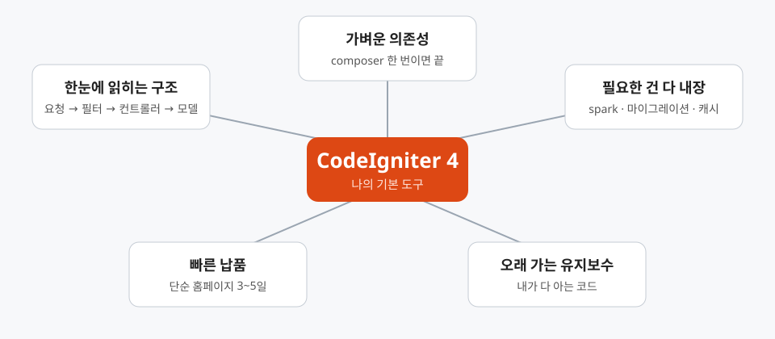

# 여러 언어를 쓸 수 있는데도, 나는 왜 CI4를 기본으로 쓰는가



PHP로 먹고산 지 25년이 됐다. 그동안 다른 언어와 프레임워크도 일이 필요하면 써 왔고, AWS·Azure·GCP 위에 MSA 백엔드 API를 설계하는 일도 전문 분야다. 그래서 가끔 "그 경력에 왜 아직 CodeIgniter 4냐"는 질문을 받는다.

이 글은 그 질문에 대한 답이다. 이 저장소(AICreo)에 쌓인 작업 기록을 근거로 썼다. 이 저장소는 1인 웹에이전시용 홈페이지·블로그 CMS 보일러플레이트다.

## 결론부터

CI4가 모든 면에서 최고라서 쓰는 게 아니다. **혼자 만들고, 혼자 운영하고, 혼자 책임지는 일에는 CI4가 가장 덜 방해한다**. 내 기준은 이 한 줄이다.

## 1. 요청 흐름이 한눈에 읽힌다

라우트 → 필터 → 컨트롤러 → 모델 → 뷰. 이 흐름이 파일 하나하나에 그대로 드러난다. 마법이 적으니 6개월 뒤에 코드를 열어도 "이게 어디서 호출되지?"를 찾느라 시간을 쓰지 않는다.

이 저장소의 예시는 이렇다.

- `/admin/*` 는 전부 `auth:admin` 필터 한 줄로 막는다.
- 방문자 IP 차단은 전역 `BlockedIpFilter` 하나가 맡는다.
- 모든 컨트롤러는 `BaseController` 를 상속하고, 설정·메뉴·로그인 사용자 정보를 한 곳에서 주입한다.

구조를 설명하는 문서보다 코드가 먼저 읽힌다. 혼자 일하는 사람에게는 이게 가장 큰 자산이다.

## 2. 의존성이 가볍다

`composer.json` 의 핵심은 `codeigniter4/framework` 하나다. 나머지는 코딩 표준, PHPStan 확장 같은 개발용이다. 업그레이드할 때 깨질 것도 적고, 보안 패치를 따라가는 비용도 낮다.

덕분에 PHP 8.5로 올릴 때도 부담이 없었다. 프레임워크가 앞서가며 요구하는 게 아니라, 언어 버전을 내가 정하고 프레임워크가 따라온다.

## 3. 필요한 건 이미 들어 있다

이 저장소에서 CI4 기본 기능만으로 해결한 일들이다.

| 하고 싶은 일 | CI4에서 쓴 것 |
|---|---|
| 테이블 생성·초기 데이터 | 마이그레이션 (`php spark migrate`) |
| 예약 발행 (`posts:publish-scheduled`) | spark 커맨드 + cron |
| 썸네일 일괄 생성 | `php spark thumbnails:generate` |
| 404 반복 IP 자동 차단 | `php spark ip:auto-block` |
| 워드프레스 글 이전·롤백 | spark 커맨드 (`WpImport`, `WpImportRollback`) |
| 설정·메뉴·배너 캐시 | 파일 캐시 + 모델 콜백으로 무효화 |
| 테마 교체 | 뷰 렌더러를 `ThemeView` 로 교체 |

특히 spark 커맨드가 좋다. 운영하다 보면 "한 번 돌리고 마는 스크립트"가 계속 생기는데, 이걸 프레임워크 안의 정식 명령으로 만들어 두면 테스트도 되고 cron에도 바로 붙는다. 서버 crontab에는 `* * * * * php spark ...` 같은 한 줄이면 충분하다.

## 4. 납품 속도가 나온다

AICreo의 목표는 **코어는 재사용하고 껍데기만 교체**해서 단순 홈페이지는 3~5일, 중형 사이트는 1~2주에 납품하는 것이다.

이게 가능한 이유는 다음과 같다.

- 게시판·권한·문의폼·관리자 패널이 이미 코어에 있다.
- 테마는 `app/Views/themes/{이름}/` 에서 다른 부분만 덮어쓰면 된다.
- 고객사가 달라도 `.env` 의 `app.baseURL` 만 바꾸면 canonical, OG, sitemap, robots가 따라온다.

프레임워크가 커서 "정답 구조"를 강요하면 이런 재사용이 어렵다. CI4는 뼈대만 주고 나머지는 내가 정하게 두니, 보일러플레이트와 궁합이 좋다.

## 5. 혼자 책임질 수 있는 크기다

기록을 보면 최근 한두 주만 해도 이런 일을 했다.

- 글 시리즈(연재) 기능과 다중 시리즈 소속
- Groq를 이용한 태그 자동 추출, 시리즈 AI 추천
- 예약 발행, 관련 글, 인기 글 위젯, 태그 클라우드
- Cloudflare 뒤에서 실제 접속자 IP를 받는 처리
- 스캐너 전형 경로를 요청한 IP의 즉시 차단
- 썸네일 생성, XSS 차단 보강

모두 한 사람이 설계하고 구현하고 운영한 일이다. 이런 속도가 가능한 건 프레임워크 내부를 내가 거의 다 안다는 데서 나온다. 문제가 생겼을 때 소스를 열어 끝까지 따라갈 수 있는 크기, 그게 CI4다.

## 6. 품질은 도구로 채운다

가볍다고 대충 짜지는 않는다. 품질 장치는 프레임워크 밖에서 붙인다.

```bash
composer cs        # PHP-CS-Fixer
composer analyse   # PHPStan 레벨 6
composer test      # PHPUnit
composer ci        # 위 셋을 한 번에
```

`pre-push` 훅이 `composer ci` 를 돌려서 통과하지 못하면 푸시되지 않는다. 약 10초면 끝나니 부담도 없다. 프레임워크가 안전망을 주지 않아도, 내가 안전망을 직접 설계하면 된다는 걸 이 저장소가 보여 준다.

## 그럼 다른 언어는 언제 쓰나

솔직하게 구분한다.

- **MSA 백엔드 API, 대규모 트래픽, 팀 개발**이면 요구에 맞는 언어와 프레임워크를 고른다. 클라우드 아키텍처는 도구가 아니라 요구가 정한다.
- **홈페이지, CMS, 소규모 서비스, 1인 운영**이면 CI4다. 여기서는 기술의 새로움보다 *내가 끝까지 책임질 수 있는가*가 기준이다.

도구를 고르는 일은 취향이 아니라 비용 계산이다. 25년 동안 쌓인 PHP 감각과 CI4의 단순함을 곱하면, 이 영역에서는 내가 낼 수 있는 가장 빠르고 안전한 속도가 나온다.

## 마무리

새로운 것을 쓰지 않는 게 아니라, **새로운 것이 필요할 때만 쓴다**. 그 외에는 가장 잘 아는 도구로 가장 빨리 끝낸다. 내가 CI4를 기본으로 쓰는 이유는 이게 전부다.
